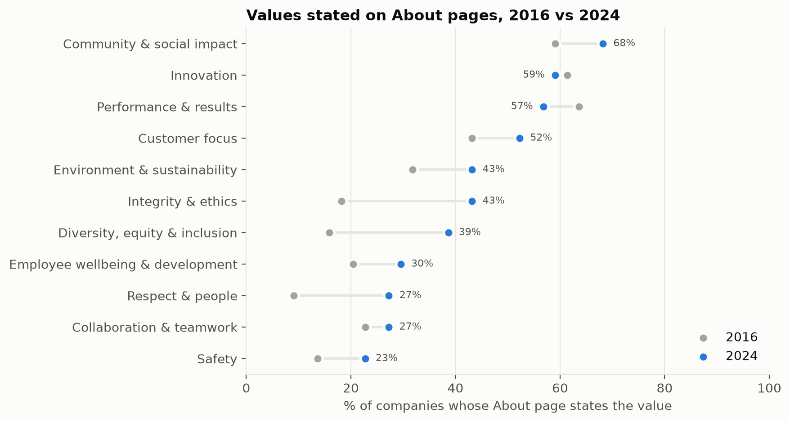

# Part 1 Summary: What 50 Large Companies Say They Value, 2016–2024

## What we did

We reconstructed how 50 of the largest U.S. companies (ten each in Technology, Financials,
Healthcare, Consumer Discretionary and Energy) described themselves on their "About Us" web pages
every year from 2016 to 2024, using the Internet Archive's Wayback Machine. For each year we
recorded whether the page changed and which of eleven values it expressed (for example,
innovation, integrity, customer focus, diversity, environment, safety), using a framework drawn
from published research on corporate values. An AI model did the reading, but every value it
reported had to be backed by a direct quote from the page, and the quotes were checked by
computer: 98% matched the page word for word.

We obtained usable pages for **402 of 450 company-years (89%)**. Every gap is documented. Most are
years the archive never saved the page, or pages built so that their text only appears when a
browser runs the site's code, so the archive stored an empty shell.

## What we found

**1. Company self-descriptions are not static.** In a typical year, about half of the companies
made a *substantive* change to their About page: adding, dropping or reframing values, not just
updating figures. Technology companies rewrote most often (65% of year-on-year changes were
substantive) and Energy and retail companies least (43%). A company's "stated values" are
therefore a moving target that has to be tracked over time rather than read once.

**2. The vocabulary of values moved from performance toward people and principles.** Between
2016 and 2024 the share of companies stating:

- **integrity and ethics** rose from 18% to 43%;
- **diversity, equity and inclusion** from 16% to 39%;
- **respect for people** from 9% to 27%;
- **safety** from 14% to 23%;
- **environment and sustainability** from 32% to 43%;

while claims about **performance and results** fell slightly (64% to 57%). Innovation and
community impact remain the most common claims throughout (about 60–70% of companies).

**3. On public web pages, diversity language did not retreat.** After 2021, as Part 2 shows,
companies cut diversity language and diversity pay targets in their formal shareholder documents.
Their About pages moved the other way: the share stating diversity kept rising through 2024. Public
messaging and formal commitments appear to be coming apart, a pattern Part 3 measures directly.

**4. The changes tell recognisable stories.** Microsoft kept its mission ("empower every person
and every organization on the planet to achieve more") while replacing 2016 strategy slogans
("mobile-first, cloud-first") with sustainability ("carbon negative by 2030") and AI. NVIDIA went
from describing its graphics heritage to describing itself as AI infrastructure. ExxonMobil stayed
anchored in supply and operations until 2024, when lower-emissions language moved to the front.
Wells Fargo's page, which featured "Vision and Values" before its 2016 sales-practices scandal, was
reduced by 2020 to generic navigation text with that wording gone.

## What this means for a reader acting on it

- **Read a company's stated values as a dated snapshot**, not a fixed identity: half change in any
  given year.
- **Values that are easy to claim are spreading fastest.** Integrity, respect and inclusion are
  rising sharply on web pages; whether they are backed by anything is what Parts 2 and 3 test.
- **Public pages lag or diverge from formal commitments.** Anyone assessing a company's
  priorities (investors, job seekers, researchers) should not rely on its web page alone.

## Caveats

- The page we tracked is chosen by written rules applied the same way to every company. For a few
  companies the rules land on an imperfect page (for Meta, Facebook's own social-media profile; for
  JPMorgan, its research institute's About page; for Intel and Berkshire Hathaway, the homepage).
  These are documented, and Part 3 tests whether they bias the results.
- The AI's judgements were checked for accurate quotation, not yet against a human coder.
- Missing years are not random: modern, script-built sites lose more snapshots.
