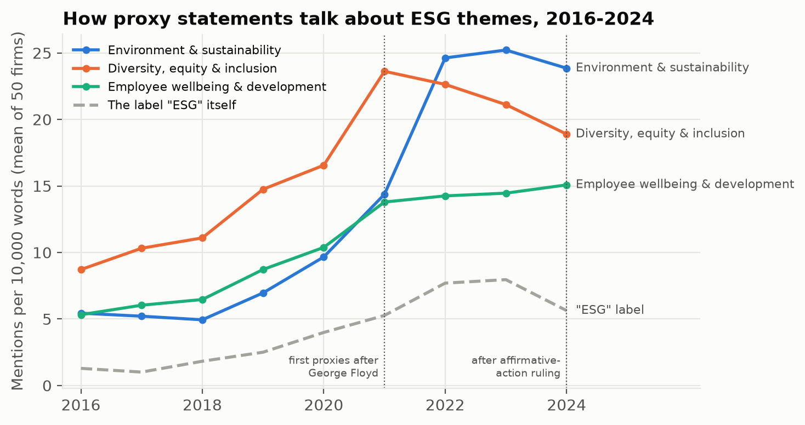
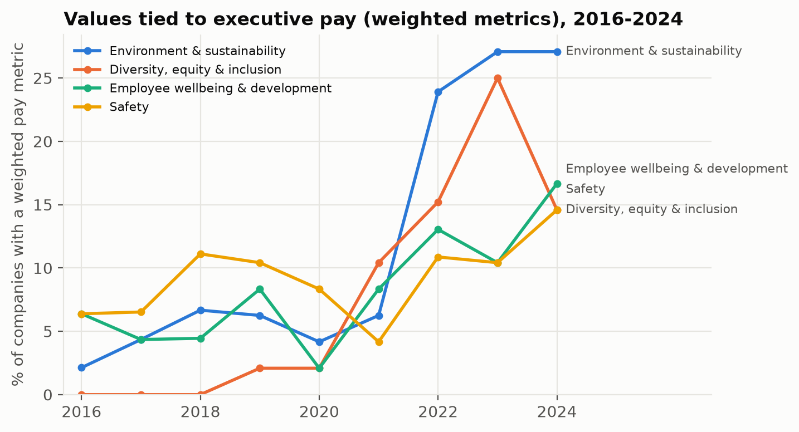

# Part 2 Summary: What Companies Tell Shareholders, and What They Pay Executives For

## What I did

Every U.S.-listed company must publish an annual **proxy statement** describing its board,
governance and **what executives are paid for**. I collected it for all 50 companies for every year
from 2016 to 2024 from the SEC's public database: **450 of 450 documents, with no gaps**. Unlike
voluntary sustainability or diversity reports, which have large gaps before 2019, proxies are
mandatory and comparable.

For each document I measured how much, how concretely and how committally it discusses the same
eleven values used in Part 1, using word lists applied identically to every document. An AI model
read each executive-pay section to find which values are **actually built into pay** (e.g. "10%
of the bonus depends on safety targets"). I tested shifts against eleven external events.

## What I found

**1. Environmental, diversity and workforce language exploded, then split.** Between 2016 and
2022, mentions of environment and sustainability rose roughly fivefold, diversity about 2.6-fold
and employee wellbeing about 2.7-fold. After 2022 the paths diverge: environmental language holds
steady, but **diversity language falls every year from its 2021 peak (−20% by 2024)**. The generic
label "ESG" fell even faster in 2024 (−30%) while the substance it labels did not. Companies are
keeping the content and dropping the politically charged word, a pattern known as "greenhushing".

**2. Some events clearly moved language beyond the background trend; others did not.**

| Event | Value it should move | Change in the next proxies | Beyond normal trend? |
|---|---|---|---|
| George Floyd's murder (May 2020) | Diversity | +48%; 88% of companies rose | Yes, strongly |
| Business Roundtable purpose statement (2019) | Community; employees | +53%; +59% | Yes |
| COVID-19 (2020) | Employee wellbeing; safety | +47%; +61% | Yes |
| ChatGPT launch (2022) | Innovation | +43% | Yes, modestly |
| BlackRock's climate letter (2020) | Environment | +102% | **No**: environment was already rising this fast every year |
| Supreme Court affirmative-action ruling (2023) | Diversity | −14%; 62% of companies cut | Yes, a reversal |

Several 2020 events reach the 2021 proxies at once, so their effects cannot be separated.

**3. Money followed words, with a lag, and retreated faster.** The share of companies tying
executive pay to an **environmental** target rose from 2% (2016) to 27% (2023–2024); to a
**diversity** target from 0% to 25% in 2023, then **dropped to 15% in 2024**, a 40% retreat in a
single year. Respect, collaboration and community are almost never tied to pay; financial results
remain the dominant metric.

**4. The tone became more committal, but rarely concrete.** In sentences about values, companies
shifted from hedged language ("we aim", "we strive", "we may") toward commitments ("we will", "we
are committed"): the share of committal wording rose from 60% in 2016 to 67% in 2021–22, easing
slightly by 2024. Healthcare companies write most committally, Technology companies most
cautiously. But commitments seldom come with numbers: even at the peak, only about one in ten
environmental sentences, and fewer than one in ten diversity sentences, contain a percentage or a
target year.

**5. Who a company is matters more than what industry it is in.** For every value, the individual
company explains far more of the variation (40–79%) than its sector (3–42%). Sector matters most
where the business demands it: Energy proxies discuss environment and safety most (about twice the
average), Financials discuss customers and diversity most, Healthcare discusses innovation most.

## What this means for a reader acting on it

- **Look at pay, not prose.** The pay section separates commitments with consequences from
  commitments in name only; ESG pay metrics are now common enough to compare across companies.
- **In a backlash, watch the costly commitments first.** Diversity pay targets were cut faster
  than diversity language, and the "ESG" label faster than environmental substance.
- **Judge companies individually.** Sector averages hide most of the variation.

## Caveats

Word counts measure attention, not quality. The event analysis is descriptive, not proof of
cause. Proxies understate environmental and community topics relative to sustainability reports.
93% of the AI's supporting quotes on pay were verified against the documents.
