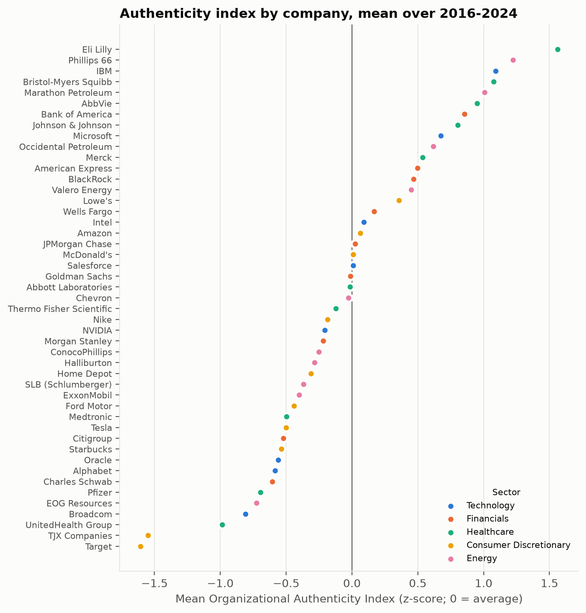
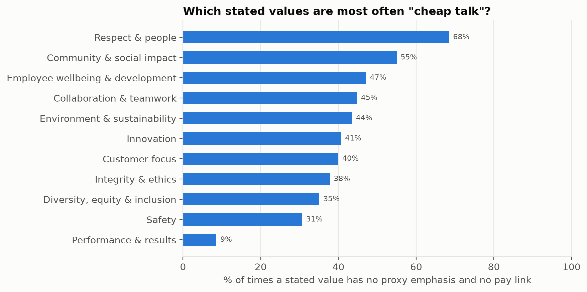

# Part 3 Summary: Do Companies Mean What They Say? An Authenticity Index

## The question

Parts 1 and 2 recorded, for 50 large U.S. companies from 2016 to 2024, what each company **says**
it values on its public web page, what it **emphasises** in its formal annual report to
shareholders (the proxy statement), and which values it **ties to executive pay**. This part
combines them into a single score for each company and year: the **Organizational Authenticity
Index**, measuring how closely what a company says matches what it formally prioritises.

## How the score works

Researchers on organisational culture distinguish the values a company *espouses* from those it
*enacts*, and call the gap between symbolic statements and real practice "decoupling". We measure
that gap in two ways, using the same eleven values throughout:

1. **Consistency of emphasis.** Does the company stress the same values in its shareholder report
   as on its web page, compared with what other companies stress that year? (Comparing with peers
   matters: every company talks about financial results, and all companies talked more about the
   environment over the decade.)
2. **Money behind words.** Of the values the web page claims, how many are built into executive pay,
   compared with how often each value is pay-linked at other companies? (Some values, like
   "respect", are rarely tied to pay anywhere, so a company is not penalised for that alone.)

The index averages the two, so 0 is the average company, positive is more aligned. We also report
two opposite ways to be inauthentic: **over-claiming** (stating a value with no sign of it in
the shareholder report or in pay: "cheap talk") and **under-claiming** (prioritising a value
without saying so publicly: "quiet virtue").

## What we found

**1. Authenticity varies widely, and it changes.** Scores cover 47 companies and 357
company-years. About half the variation is between companies and half is the same company
changing over time, so authenticity is not a fixed trait.

**2. Energy and Healthcare are most aligned; consumer companies least.** Energy companies that
claim safety tie executive pay to it 69% of the time (other sectors: 13%), and healthcare
companies that claim innovation tie it to pay 64% of the time (consumer companies: 17%).
Consumer companies state broad community, customer and people values that rarely appear in their
pay plans. Highest on average: Eli Lilly, Phillips
66, IBM, Bristol-Myers Squibb, Marathon Petroleum. Lowest: Target, TJX, UnitedHealth, Broadcom,
EOG Resources.

**3. Alignment improved after 2020.** The share of stated values with no backing fell from about
half (2016–2017) to under a third (2023–2024), as companies added ESG and people metrics to pay.

**4. People-related values are the cheapest talk.** When a company claims "respect", it has no
supporting emphasis or pay link 68% of the time; community impact 55%, employee wellbeing 47%. By
contrast, claims about financial performance are almost always backed (only 9% unbacked).
Companies put their money behind results and safety, and their words behind people.

## How far to trust it

We checked whether the index behaves as it should. It passes most checks: the two parts measure
different things, rankings barely change if either part or any single value is removed, and it
is not simply rewarding longer web pages. **One check is revealing.** Wells Fargo should score low
after its fake-accounts scandal became public in late 2016, and in 2017–2018 it does score slightly
below other banks, though on too few years to be conclusive. But in 2016, while the misconduct
was happening and before it was public, Wells Fargo scored as the *most* aligned bank: its web
page and its shareholder report told the same story of customers and integrity. The index is a
measure of whether a company's **statements and incentives are consistent with each other**. It
cannot see conduct that contradicts them, and a company under pressure can raise its score simply
by saying the right things everywhere at once.

## What this means for a reader acting on it

- **Use the index to find claims that lack backing**, especially in people-related values, not as
  a verdict on corporate character.
- **Check over-claiming, not just the overall score:** it shows which specific values are
  unsupported.
- **Pair it with outcome data** (complaints, safety violations, enforcement) before drawing
  conclusions about any single company. Adding that evidence is the natural next step.
