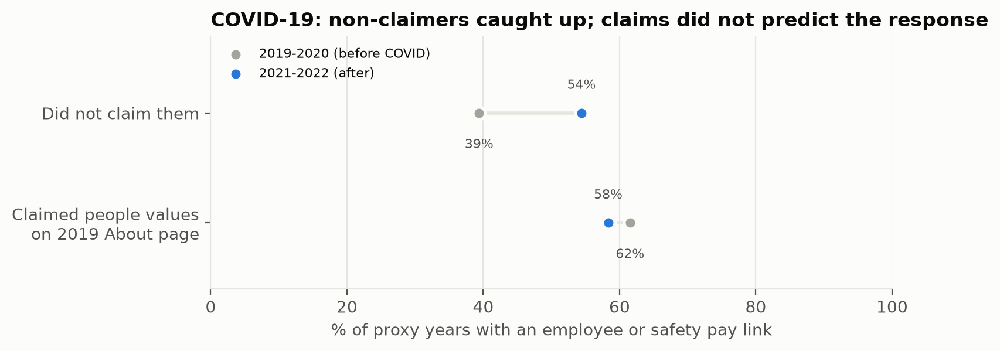
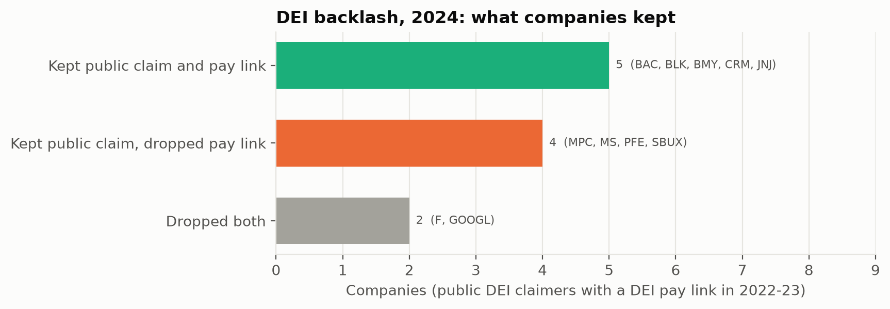

# Part 4 Summary: Does a Crisis Reveal Whether Corporate Values Are Authentic?

## The question

It is often said that you see a company's true values in a crisis: values that cost nothing in
good times have to be paid for in bad ones. If that is true, crises are the best test of whether a
company meant what it said. If it is not, and crises simply prompt every company to say the right
things at once, then crisis periods are when stated values tell us the *least*.

Part 3 gave a reason for doubt. In 2016, while Wells Fargo's fake-accounts misconduct was under
way but not yet public, our authenticity index rated it the most aligned bank in the sample; and
in the scandal years its shareholder documents mentioned integrity two to three times as often as
other banks'.

## What we did

We used two crises that put a specific value under pressure, and asked whether companies that
publicly claimed that value *before* the crisis behaved differently *after* it:

- **COVID-19**, when "people first" became expensive. Did companies whose web page claimed employee
  wellbeing or safety in 2019 increase their attention to employees and safety, and tie more
  executive pay to them, than companies that made no such claim? We also identified, from audited
  SEC financial data, which companies actually lost revenue in 2020: those were the ones whose
  claim was truly costly to keep.
- **The DEI backlash of 2022–2024**, when diversity commitments became politically risky. Did
  companies that had publicly championed DEI keep their DEI commitments longer than those that had
  not?

The analysis reuses the data from Parts 1–3 plus public SEC financial data.

## What we found

**1. During COVID-19, prior claims made no difference.** Companies that had claimed people values
and those that had not increased their attention to employees and safety by about the same amount.
On executive pay, the companies that had *not* claimed people values caught up: their share with
an employee or safety pay metric rose from 39% to 54%, almost reaching the claimers (58%). The
crisis made companies more alike rather than separating real commitments from talk. Among
companies whose revenue fell, the few claimers (all oil companies) actually *reduced* their safety
language.

**2. In the DEI backlash, public claims survived and costly commitments did not.** Companies that
had publicly championed DEI dropped DEI targets from executive pay at least as often as companies
that had not (only 38% kept them, versus 57%). Yet 80% of the public champions still featured DEI
on their web page in 2024. Of 11 companies that had both claimed DEI publicly and tied pay to it,
five kept both, two dropped both, and four, **Marathon Petroleum, Morgan Stanley, Pfizer and
Starbucks**, kept the public claim while dropping the pay commitment.

**3. Wells Fargo shows crisis as performance.** After its scandal broke, its integrity language
stayed at about twice the level of other banks for five years, then returned to normal in 2022.

## The answer

**Not in the way the saying suggests.** In neither crisis did what a company said beforehand
predict how it responded. What crises *do* reveal is which commitments a company protects: the
cheap, public statement is the last thing to go, and the costly commitment (money attached to a
value) is the first. Under pressure, the gap between saying and doing tends to widen.

## What this means for a reader acting on it

- **Discount value statements made during or right after a crisis.** That is when every company
  says the right things.
- **Watch what survives the next crisis, not what is said in it.** The clearest sign of a genuine
  value is a costly commitment (a pay metric, a quantified target) that is kept when it becomes
  expensive or controversial.
- **Treat a public claim without a matching commitment as a warning sign**, especially after a
  backlash: four of eleven DEI champions now fit that pattern.

## Caveats

The samples are small (about a dozen companies in each comparison), so only large differences
could be detected, and most differences were not statistically significant; the conclusions rest
on the consistent direction of the results and on the company-level DEI breakdown. Companies that
make public claims differ from those that do not (for example, by sector), so these are patterns,
not proof of cause. Several 2020 events hit at once, and lost revenue is only a rough measure of
how costly a commitment became.
